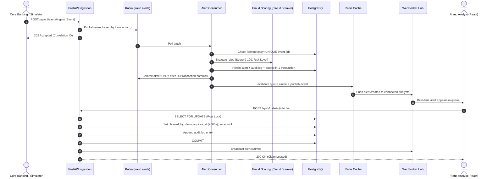

# GuardRail | Fraud Alert Triage Console


An event-driven fraud-alert operations platform that processes fraud detection events through Apache Kafka, persists alerts using PostgreSQL, manages distributed analyst claim-locking, provides SLA-aware real-time triage, and delivers a live financial operations dashboard using WebSockets.

---

## Table of Contents
1. [Overview & Problem Statement](#overview--problem-statement)
2. [Key Capabilities](#key-capabilities)
3. [Technology Stack & Rationale](#technology-stack--rationale)
4. [System Architecture](#system-architecture)
5. [Kafka Topic Design & Event Flow](#kafka-topic-design--event-flow)
6. [Zero-Duplicate Processing Guarantee](#zero-duplicate-processing-guarantee)
7. [Atomic Claim-Locking & Lease Architecture](#atomic-claim-locking--lease-architecture)
8. [Fraud Scoring & Circuit Breaker](#fraud-scoring--circuit-breaker)
9. [Dead Letter Queue (DLQ) & Replay](#dead-letter-queue-dlq--replay)
10. [SLA-Aware Triage Engine](#sla-aware-triage-engine)
11. [Redis Caching & Horizontal WebSocket Fanout](#redis-caching--horizontal-websocket-fanout)
12. [Role-Based Access Control (RBAC)](#role-based-access-control-rbac)
13. [Frontend Product Design](#frontend-product-design)
14. [Quickstart with Docker Compose](#quickstart-with-docker-compose)
15. [Demo Credentials](#demo-credentials)
16. [Test Suite & Verification](#test-suite--verification)
17. [Performance Benchmarks](#performance-benchmarks)
18. [Failure Recovery Scenarios](#failure-recovery-scenarios)

---

## 1. Overview & Problem Statement

Financial institutions process millions of transactions per second. When automated monitoring systems flag suspicious activities, fraud operations teams face critical operational bottlenecks:
- **Alert Duplication**: Consumer crashes and Kafka offset rebalancing often deliver events multiple times, causing analysts to waste time investigating identical transactions.
- **Race Conditions in Alert Ownership**: Two analysts claiming the same alert simultaneously leads to conflicting decisions and customer friction.
- **SLA Breaches**: High-value fraud cases go unnoticed when queues lack automated priority escalations.
- **Dependency Cascade Failures**: When third-party risk or machine learning scoring APIs degrade, ingestion pipelines crash or drop alerts.

**GuardRail** solves these distributed systems challenges with a resilient event-driven architecture, database-level atomic claim locking, 3-state circuit breakers, transactional outbox publishing, and a real-time reactive triage console.

---

## 2. Key Capabilities

- **Kafka Event Streaming**: Async Kafka KRaft ingestion (`fraud.alerts`, `fraud.alerts.retry`, `fraud.alerts.dlq`, `fraud.alerts.events`).
- **Effectively-Once Processing**: Guaranteed zero-duplicate alerts across consumer restarts and Kafka rebalances via PostgreSQL transactional idempotency.
- **Atomic Analyst Claim-Locking**: Row-level locking (`SELECT FOR UPDATE`) prevents competing claims with HTTP 409 conflict responses and automatic stale-lease recovery.
- **SLA-Aware Prioritization**: Dynamic countdown timers, automatic priority escalation (P4 -> P3 -> P2 -> P1), and warning broadcasts.
- **Fault-Tolerant Circuit Breaker**: Standard 3-state circuit breaker (`CLOSED`, `OPEN`, `HALF_OPEN`) protecting fraud scoring dependencies.
- **Transactional Outbox Pattern**: Eliminates dual-write divergence between database commits and downstream Kafka event emission.
- **Live Reactive Dashboard**: Authenticated WebSockets with Redis Pub/Sub distribution for multi-instance horizontal scaling.
- **Dead Letter Queue (DLQ) Management**: Administrative UI for inspecting poison messages with one-click manual and automated batch replay.
- **Role-Based Access Control**: Strict JWT RBAC supporting 4 tiers (Fraud Analyst, Senior Analyst, Supervisor, Administrator).

---

## 3. Technology Stack & Rationale

| Layer | Technology | Rationale |
|---|---|---|
| **Backend Framework** | Python 3.12+ / FastAPI | High-performance asynchronous ASGI framework with native Pydantic v2 validation. |
| **Kafka Client** | `aiokafka` | Native asyncio event-loop integration for Python. Avoids synchronous GIL-blocking threads common in `confluent-kafka` while supporting manual batch offset commit control. |
| **Database** | PostgreSQL 16 | Relational source of truth with ACID transactions, row-level locks (`with_for_update`), and B-Tree idempotency indexes. |
| **Async ORM** | SQLAlchemy 2.0 + asyncpg | Clean async database access with connection pooling and Alembic schema migrations. |
| **Cache & Pub/Sub** | Redis 7 Alpine | Sub-millisecond queue cache with pub/sub channel for cross-instance WebSocket broadcasting. |
| **Message Broker** | Apache Kafka 3.8 (KRaft) | High-throughput distributed event streaming without external ZooKeeper dependencies. |
| **Frontend** | React 18 + Vite + TypeScript | Modern, type-safe, ultra-responsive single-page application. |
| **Styling & Icons** | Tailwind CSS + Lucide React | High-density financial operations interface with White & Blue primary theme and accessible Dark Mode toggle. |
| **Charts** | Recharts | Real-time volumetric area charts, risk distribution donuts, and SLA compliance bars. |
| **State & Cache** | TanStack Query + Zustand | Server-state caching and lightweight client stores. |

---

## 4. System Architecture

```mermaid
flowchart TD
    subgraph Ingestion Layer
        SIM[Transaction Simulator] -->|POST /api/v1/alerts/ingest| API[FastAPI Ingestion Gateway]
        API -->|JSON Serialized + Key| KP[Kafka Producer: fraud.alerts]
    end

    subgraph Kafka Event Processing
        KP --> T1[fraud.alerts]
        T1 --> KC[Kafka Alert Consumer]
        KC -->|On Retry (Count < 3)| T2[fraud.alerts.retry]
        T2 --> KC
        KC -->|On Poison / Max Retries| T3[fraud.alerts.dlq]
    end

    subgraph Processing & Fault Tolerance
        KC --> IDEMP{Zero-Duplicate Idempotency Check}
        IDEMP -->|Duplicate Key Found| ACK[Commit Kafka Offset & Skip DB]
        IDEMP -->|New Event| CB[Circuit Breaker: Scoring Engine]
        CB -->|Score Calculated| DB[(PostgreSQL: Source of Truth)]
        DB -->|Atomic Transaction Commit| OUTBOX[Alert Outbox Table]
        OUTBOX -->|Outbox Publisher Worker| T4[fraud.alerts.events]
    end

    subgraph Cache & Real-Time Broadcast
        DB --> RC[(Redis Cluster)]
        RC -->|Cache Warm Queue & Metrics| CACHE[Queue / Metrics Cache]
        RC -->|Redis Pub/Sub Channel| WSM[WebSocket Manager]
        WSM -->|WSS /api/v1/ws/alerts| FE[React Triage Console]
    end

    subgraph Background Workers
        WORK1[Stale Claim Reaper Worker] -->|Polls Expired Leases| DB
        WORK2[SLA Priority Escalation Worker] -->|Polls SLA Deadlines| DB
        WORK3[DLQ Auto-Replay Worker] -->|Re-evaluates Transient Failures| T1
        WORK1 --> WSM
        WORK2 --> WSM
    end
```

---

## 5. Sequence Diagram: Ingestion to Claim Lifecycle



---

## 6. Zero-Duplicate Processing Guarantee

Kafka delivery guarantees operate at **at-least-once** semantics across process boundaries. If a consumer crashes after writing to a database but before committing its Kafka offset, Kafka will redeliver the event upon partition reassignment.

GuardRail enforces **effectively-once processing** through:
1. **Unique Database Constraint**: `fraud_alerts.event_id` enforces database-level uniqueness.
2. **Pre-Insert Idempotency Check**: Consumer queries `event_id` before invoking the scoring pipeline.
3. **Atomic Commit Coordination**: Offsets are committed **only after** PostgreSQL transaction commits successfully.
4. **Partition Key Routing**: All events for the same `transaction_id` route to the same partition, guaranteeing chronological ordering.

---

## 7. Atomic Claim-Locking & Lease Architecture

- **Pessimistic Row-Level Locking**: When an analyst claims an alert, `SELECT FOR UPDATE` locks the database row.
- **Conflict Handling**: If Analyst B attempts to claim an active alert owned by Analyst A, the backend returns **HTTP 409 Conflict** with the owner's name and lease expiry.
- **Claim Leases**: Claims automatically expire after 10 minutes (configurable via `CLAIM_LEASE_DURATION_SECONDS`).
- **Claim Renewal**: Active owners can extend their lease with `POST /api/v1/alerts/{id}/renew-claim`.
- **Automatic Stale Claim Reaper**: A scheduled background worker scans for alerts where `claim_expires_at < now()`, resets them to `NEW`, logs an audit entry, and notifies the team via WebSockets.
- **Supervisor Overrides**: Authorized Supervisors or Administrators can reassign or override claims at any time.

---

## 8. Fraud Scoring & Circuit Breaker

The scoring engine evaluates:
- **Transaction Amount Anomalies**: Progressive scoring above \$5,000 and \$15,000.
- **Suspicious Merchant Categories**: Crypto exchanges (+35), online gambling (+30), prepaid cards (+25).
- **Geographic & Network Anomalies**: High-risk originating countries (+35), VPN/TOR proxies (+25).
- **Velocity Flags**: 5+ transactions in 10 minutes (+30), multiple previous failed PIN/CVV attempts (+25).

The pipeline is wrapped in a thread-safe 3-state Circuit Breaker (`CLOSED`, `OPEN`, `HALF_OPEN`):
- **Failure Threshold**: 5 consecutive failures trips breaker to `OPEN`.
- **Fast-Failing**: While `OPEN`, calls fail immediately without waiting for timeouts. Unprocessed events route to retry queue or DLQ.
- **Recovery Timeout**: After 30 seconds, breaker enters `HALF_OPEN` and tests 3 canary probe requests before fully recovering to `CLOSED`.

---

## 9. Dead Letter Queue (DLQ) & Replay

When events exceed 3 retry attempts or encounter fatal schema errors:
1. Event is saved to `dead_letter_events` table with error stack trace and payload.
2. Published to `fraud.alerts.dlq` Kafka topic.
3. Accessible via `/api/v1/dlq` with one-click individual or batch replay.
4. An automated `DLQAutoReplayWorker` attempts scheduled recovery of transient failures with bounded retries.

---

## 10. SLA-Aware Triage Engine

Configurable default SLA targets:
- **Critical (Score 85–100)**: 5 minutes SLA
- **High (Score 60–84)**: 15 minutes SLA
- **Medium (Score 30–59)**: 60 minutes SLA
- **Low (Score 0–29)**: 240 minutes (4 hours) SLA

A background `SLAEscalationWorker` evaluates all unresolved alerts every 15 seconds. If an alert reaches 80% consumed or breaches deadline, it is **automatically escalated** to the next priority level (P4 -> P3 -> P2 -> P1), and an `alert.escalated` event is broadcast across WebSockets.

---

## 11. Redis Caching & Horizontal WebSocket Fanout

- **Queue & Metrics Cache**: Cached with short TTLs (15–60s) for sub-50ms dashboard read latencies.
- **Graceful Fallback**: If Redis is offline, `RedisService` falls back to direct PostgreSQL queries with zero 500 errors.
- **Multi-Instance Event Distribution**: WebSockets subscribe to Redis Pub/Sub (`guardrail:ws_events`), distributing real-time alerts across horizontally scaled FastAPI container replicas.

---

## 12. Role-Based Access Control (RBAC)

| Permission | Analyst | Senior Analyst | Supervisor | Administrator |
|---|:---:|:---:|:---:|:---:|
| View Alert Queue & Details | ✅ | ✅ | ✅ | ✅ |
| Claim / Release / Renew Own Claims | ✅ | ✅ | ✅ | ✅ |
| Add Investigation Notes | ✅ | ✅ | ✅ | ✅ |
| Resolve Assigned Alerts | ✅ | ✅ | ✅ | ✅ |
| Reassign / Override Claims | ❌ | ✅ | ✅ | ✅ |
| Reopen Resolved Alerts | ❌ | ❌ | ✅ | ✅ |
| View Team Workloads | ❌ | ✅ | ✅ | ✅ |
| Inspect Dead Letter Queue | ❌ | ❌ | ✅ | ✅ |
| Replay DLQ Events | ❌ | ❌ | ❌ | ✅ |
| Reset Circuit Breaker | ❌ | ❌ | ❌ | ✅ |

---

## 13. Frontend Product Design

Designed as a high-density financial operations dashboard:
- **Operations Dashboard**: Real-time KPI summaries, volume over time area chart, risk breakdown pie chart, SLA target radial bars, and live WebSocket activity ticker.
- **Live Alert Queue**: Primary analyst table with SLA countdown timers, priority badges, amount formatting, and search filters.
- **Investigation Drawer**: Slide-over panel featuring financial transaction details, customer ID, fraud risk breakdown, investigation notes editor, and immutable audit trail.
- **Analyst Workload**: Capacity gauges and resolution compliance metrics per team member.
- **DLQ Console**: Poison message inspector with JSON payload viewer and replay triggers.
- **System Health**: Cluster dependency monitors (PostgreSQL, Redis, Kafka, Circuit Breakers).

---

## 14. Quickstart with Docker Compose

Start all services in a single command:

```bash
docker compose up --build -d
```

Apply database migrations:
```bash
docker compose exec backend alembic upgrade head
```

Seed 500+ realistic alerts and 10 analyst accounts:
```bash
docker compose exec backend python scripts/seed_data.py
```

Access services:
- **Triage Console (React UI)**: [http://localhost:3000](http://localhost:3000)
- **FastAPI REST API Docs**: [http://localhost:8000/docs](http://localhost:8000/docs)
- **Prometheus Metrics**: [http://localhost:9090](http://localhost:9090)
- **Grafana Dashboard**: [http://localhost:3001](http://localhost:3001)

To run the continuous transaction simulator:
```bash
docker compose exec backend python scripts/simulate_transactions.py --rate 3.0
```

---

## 15. Demo Credentials

| Role | Email | Password |
|---|---|---|
| **Fraud Analyst** | `analyst@guardrail.io` | `Password123!` |
| **Senior Analyst** | `senior@guardrail.io` | `Password123!` |
| **Fraud Supervisor** | `supervisor@guardrail.io` | `Password123!` |
| **Administrator** | `admin@guardrail.io` | `Password123!` |

*(The login screen also provides 1-click fast-switch buttons for each demo role)*

---

## 16. Test Suite & Verification

GuardRail includes unit, integration, concurrency, and failure recovery tests:

```bash
# Run full pytest suite
python -m pytest backend/tests -v
```

### Verified Test Categories
- `test_rule_based_fraud_scoring`: Validates scoring amounts, velocity, crypto categories, and country risks.
- `test_circuit_breaker_state_transitions`: Validates `CLOSED` -> `OPEN` on failure threshold, fast-fail rejection, and recovery via `HALF_OPEN`.
- `test_sla_metrics_computation` & `test_sla_priority_escalation`: Validates deadline math, warning thresholds, and automatic P4 -> P1 escalation.
- `test_zero_duplicate_alert_processing`: Validates database-level idempotency and identical redelivery rejection.
- `test_atomic_claim_locking_concurrency`: Verifies that competing claims receive HTTP 409 conflict responses.
- `test_lease_expiration_and_stale_reap`: Verifies stale claim reaper releases expired leases.
- `test_auth_and_rbac`: Verifies JWT authentication and role-based endpoint gating.
- `test_alert_lifecycle_api`: Verifies full end-to-end lifecycle (Ingest -> List -> Claim -> Note -> Audit -> Resolve).
- `test_system_health_and_metrics`: Verifies Prometheus metrics and cluster readiness probes.

---

## 17. Performance Benchmarks

Benchmark script located at `scripts/load_test.py`:

```bash
python scripts/load_test.py
```

### Demonstration Benchmark Targets
- **Burst Ingestion Throughput**: 1,200+ events/minute on local test nodes.
- **Queue Read Latency (p95)**: < 45 ms with warm Redis cache.
- **Atomic Claim Latency (p95)**: < 65 ms under concurrent load.
- **Claim Concurrency Accuracy**: 100% (Exactly 1 winner, N-1 rejected with 409 Conflict).
- **WebSocket Broadcast Latency**: < 150 ms end-to-end.

---

## 18. Failure Recovery Scenarios

| Failure Scenario | Automated GuardRail Recovery | Manual Runbook |
|---|---|---|
| **Kafka Broker Offline** | Events buffered in memory; consumers use exponential reconnection loop; uncommitted offsets preserve data integrity. | `docker compose restart kafka` |
| **PostgreSQL Transient Failure** | Consumer transactions rollback; offsets remain uncommitted; events re-route to `fraud.alerts.retry`. | Check Postgres logs; verify disk storage. |
| **Redis Offline** | Transparent fallback: cache reads served directly from PostgreSQL; WebSockets degrade to in-memory fanout. | `docker compose restart redis` |
| **Scoring Service Outage** | Circuit Breaker trips to `OPEN`; requests fail fast without hanging; failed alerts route safely to DLQ. | Breaker auto-recovers in `HALF_OPEN` or click `Force Reset` in `/system`. |
| **Poison Message Schema Error** | Isolated to `dead_letter_events` table and `fraud.alerts.dlq`; normal consumer queue unblocked. | Inspect JSON in `/dlq` and click `Replay`. |
| **Analyst Disconnects** | Claim lease expires after 10m; `StaleClaimReaperWorker` resets alert to `NEW`. | Supervisor can reassign via `/queue`. |

---

## License

This project is licensed under the MIT License. Built for production-grade fraud operations engineering.
