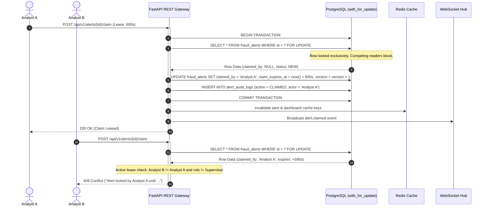

# GuardRail Architecture & Distributed Systems Design

## 1. System Overview

GuardRail is an event-driven fraud operations platform designed to ingest, process, score, persist, and triage high-volume financial transaction alerts in real time with effectively-once processing guarantees, atomic distributed claim-locking, and SLA enforcement.

```mermaid
flowchart TD
    subgraph Ingestion Layer
        SIM[Transaction Simulator / Core Banking] -->|POST /api/v1/alerts/ingest| API[FastAPI Ingestion Gateway]
        API -->|JSON Serialized + Idempotency Key| KP[Kafka Producer: fraud.alerts]
    end

    subgraph Kafka Event Backbone
        KP --> T1[fraud.alerts]
        T1 --> KC[Kafka Alert Consumer]
        KC -->|On Retry (Count < 3)| T2[fraud.alerts.retry]
        T2 --> KC
        KC -->|On Poison / Max Retries| T3[fraud.alerts.dlq]
    end

    subgraph Processing & Fault Tolerance
        KC --> IDEMP{Zero-Duplicate Idempotency Check}
        IDEMP -->|Duplicate Key Found| ACK[Commit Kafka Offset & Skip DB]
        IDEMP -->|New Event| CB[Circuit Breaker: Scoring Engine]
        CB -->|Score Calculated| DB[(PostgreSQL: Source of Truth)]
        DB -->|Atomic Transaction Commit| OUTBOX[Alert Outbox Table]
        OUTBOX -->|Outbox Publisher Worker| T4[fraud.alerts.events]
    end

    subgraph Cache & Real-Time Broadcast
        DB --> RC[(Redis Cluster)]
        RC -->|Cache Warm Queue & Metrics| CACHE[Queue / Metrics Cache]
        RC -->|Redis Pub/Sub Channel| WSM[WebSocket Manager]
        WSM -->|WSS /api/v1/ws/alerts| FE[React Triage Console]
    end

    subgraph Background Workers
        WORK1[Stale Claim Reaper Worker] -->|Polls Expired Leases| DB
        WORK2[SLA Priority Escalation Worker] -->|Polls SLA Deadlines| DB
        WORK3[DLQ Auto-Replay Worker] -->|Re-evaluates Transient Failures| T1
        WORK1 --> WSM
        WORK2 --> WSM
    end
```

---

## 2. Event-Driven Backbone & Topic Topology

Kafka is configured in **KRaft** (Kafka Raft Metadata) mode, eliminating external ZooKeeper dependencies and providing sub-second controller failover.

| Topic Name | Partitions | Replication | Retention | Purpose |
|---|---|---|---|---|
| `fraud.alerts` | 3 | 1 (Local) / 3 (Prod) | 7 days | Primary raw incoming transaction events published by ingestion gateway. Partitioned by `transaction_id`. |
| `fraud.alerts.retry` | 3 | 1 (Local) / 3 (Prod) | 3 days | Intermediate exponential backoff retry queue for transient dependency timeouts. |
| `fraud.alerts.dlq` | 3 | 1 (Local) / 3 (Prod) | 30 days | Dead letter storage for exhausted retries, unparseable schemas, and poison payloads. |
| `fraud.alerts.events` | 3 | 1 (Local) / 3 (Prod) | 14 days | Downstream domain event stream populated by the Transactional Outbox worker for analytics and reporting. |

---

## 3. Effectively-Once Processing & Zero-Duplicate Ingestion

### Why Kafka Alone Is Not "Exactly Once" Across Databases
Kafka provides at-least-once delivery guarantees by default (or idempotent producer and transactional consumers across Kafka-to-Kafka boundaries). However, **Kafka cannot automatically coordinate atomic two-phase commits across external storage systems like PostgreSQL.** 

If a consumer writes a row to PostgreSQL and crashes before committing the offset to Kafka, the rebalanced consumer will read the event a second time.

### GuardRail Zero-Duplicate Protocol
1. **Stable Idempotency Key**: Every incoming event has a unique `event_id` (either provided by upstream core banking or generated at gateway entry).
2. **PostgreSQL Constraint**: The `fraud_alerts.event_id` column has a strict `UNIQUE` B-Tree index.
3. **Pre-Insert Existence Check**: The consumer queries the index prior to evaluating heavy ML/scoring pipelines.
4. **Row-Level Transaction Boundary**: If another thread/worker races with the same `event_id`, PostgreSQL conflict handling enforces that only one transaction succeeds.
5. **Post-Commit Offset Management**: The Kafka consumer commits offset to Kafka **ONLY after the PostgreSQL transaction successfully commits**.

---

## 4. Atomic Analyst Claim-Locking & Lease Architecture

In high-pressure fraud operations, multiple analysts must never simultaneously investigate or take conflicting action on the same customer alert.

### Atomic Claim Protocol


### Stale Lease Recovery (Reaper Worker)
If an analyst's network drops or they walk away from their workstation, the alert is not permanently trapped. A background worker periodically inspects:
```sql
SELECT id FROM fraud_alerts 
WHERE claimed_by IS NOT NULL 
  AND claim_expires_at < NOW() 
  AND status NOT IN ('RESOLVED', 'CLOSED');
```
Expired claims are atomically released, logged to the immutable audit trail with actor `CLAIM_REAPER_WORKER`, and broadcast via WebSockets so another analyst can claim them.

---

## 5. Fraud Scoring Engine & 3-State Circuit Breaker

The fraud evaluation pipeline is guarded by a thread-safe 3-state Circuit Breaker (`CLOSED`, `OPEN`, `HALF_OPEN`):

- **CLOSED**: Default state. All transactions are scored. If consecutive timeouts/exceptions reach `failure_threshold` (default: 5), the circuit trips to **OPEN**.
- **OPEN**: All scoring calls fail fast immediately with `CircuitBreakerOpenException` without overloading downstream dependencies. The consumer routes events to `fraud.alerts.retry` with exponential backoff.
- **HALF_OPEN**: After `recovery_timeout` (default: 30s), limited canary probes (default: 3) are allowed through. If all probe calls succeed, the circuit recovers to **CLOSED**. Any failure immediately throws the breaker back to **OPEN**.
